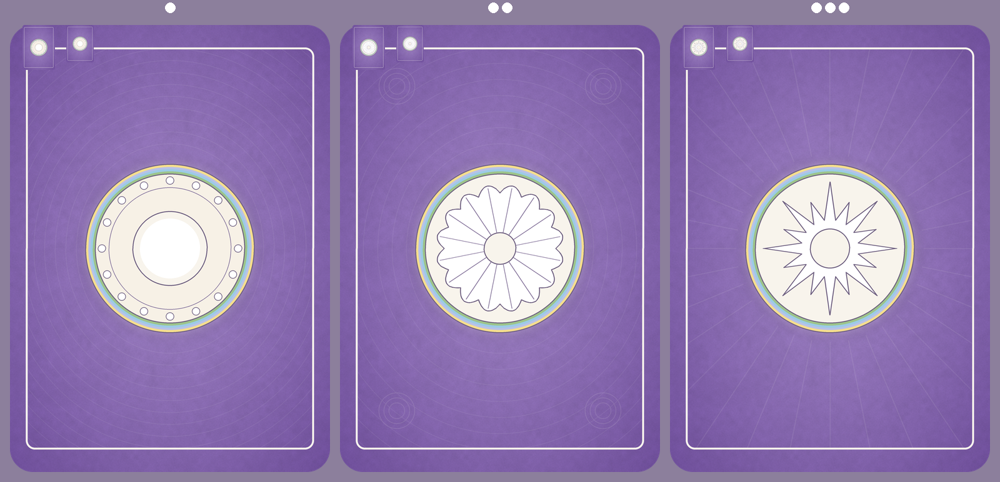
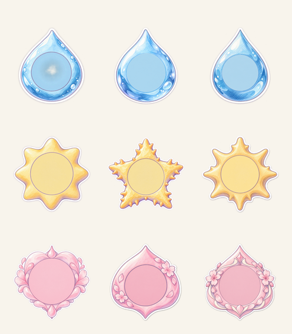
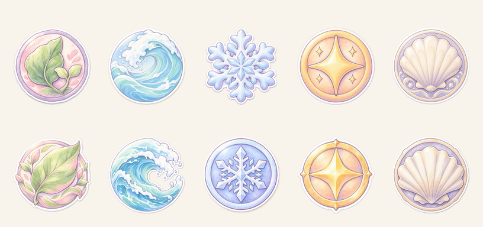
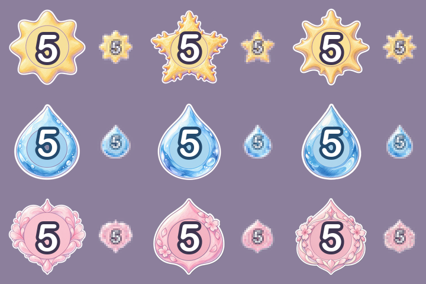
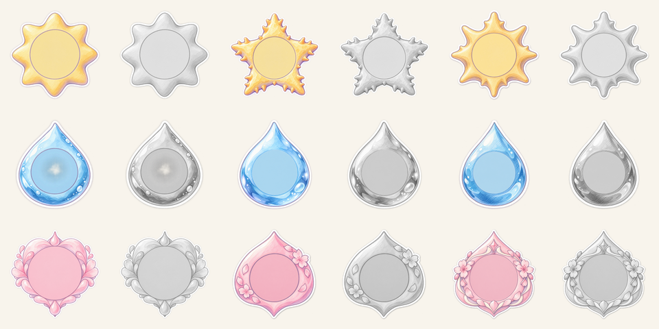

# 美術素材簽核對照頁 batch-20261022-card

- 批次：`batch-20261022-card`
- 生成日期：2026-10-22
- 整理：AI 依委託單產出並自檢，不代表通過，全部等待人類終審
- 委託單：`docs/art/orders/20261022-card-back.md`、`docs/art/orders/20261022-card-front-frame.md`、`docs/art/orders/20261022-battle-background.md`
- 風格參考圖（以 `-i` 帶入 Codex）：`assets/_source/portraits/xiaoye.png`、`assets/_source/cards/tide-003.png`、`assets/_source/cards/frost-001.png`
  - xiaoye 不在 `assets/_source/cards/`，改用 `assets/_source/portraits/xiaoye.png`
  - 委託單原寫 `role1.png`、`role2.png`，本批依派工改用上述三張角色圖
- 下方「美術總監建議」只是建議，選用與否由人類決定

## 1. card-back 卡背

**三個變體全部程序化產出，旋轉 180 度後 PNG 逐像素完全一致，WebP 平均每通道差約 0.8 到 1.1**

### 變體清單

- a 珍珠紋章
  - `../../assets/pending/batch-20261022-card/card-back/card-back-a@2x.webp`、`card-back-a@2x.png`
  - `../../assets/pending/batch-20261022-card/card-back/card-back-a.webp`、`card-back-a.png`
- b 扇貝紋章
  - `../../assets/pending/batch-20261022-card/card-back/card-back-b@2x.webp`、`card-back-b@2x.png`
  - `../../assets/pending/batch-20261022-card/card-back/card-back-b.webp`、`card-back-b.png`
- c 星芒放射紋章
  - `../../assets/pending/batch-20261022-card/card-back/card-back-c@2x.webp`、`card-back-c@2x.png`
  - `../../assets/pending/batch-20261022-card/card-back/card-back-c.webp`、`card-back-c.png`
- 縮圖：`../../assets/pending/batch-20261022-card/card-back/_thumbs/card-back-<變體>-52x72.png`、`card-back-<變體>-44x60.png`

### 縮圖對照

- contact sheet 每張卡背左上角疊有 52 x 72 與 44 x 60 實際尺寸縮圖

### 來源

- Codex 程序化腳本 `tools/art/card-back.py`（Python 3、Pillow、numpy；numpy 為 `tools/remove-bg.py` 既有依賴）
- 種子 20261022，三個變體同種子
- 檢查腳本 `tools/art/check-card-back.py`

### 驗收標準自檢

- 尺寸與格式：通過
  - 2x 為 1024 x 1432，1x 為 512 x 716，長寬比 5:7，WebP 含 alpha 與 PNG 齊全
- 圓角外四角 alpha = 0：通過
  - 12 個檔案四角 alpha 皆為 0
- 旋轉 180 度平均每通道差小於 3：通過
  - a：PNG 2x 為 0.000、PNG 1x 為 0.000、WebP 2x 為 0.880、WebP 1x 為 1.107
  - b：PNG 2x 為 0.000、PNG 1x 為 0.000、WebP 2x 為 0.874、WebP 1x 為 1.102
  - c：PNG 2x 為 0.000、PNG 1x 為 0.000、WebP 2x 為 0.807、WebP 1x 為 1.055
  - WebP 的差來自有損壓縮，藍色通道最大約 1.38
- 四邊 5% 安全邊界內沒有紋樣主體：通過
  - 腳本把底紋限制在內框以內，安全邊界內底紋像素數為 0
  - 邊界帶亮度標準差 4.8 到 4.9，只有底色漸層與水彩顆粒
- 不含文字、數字、品牌、真人、角色：通過
  - 全部由幾何形狀繪製，沒有使用字型
- 四陣營色環面積相近：通過
  - 2x PNG 色環像素：葉 9642、潮 10274、霜 10596、光 10040，最大最小比 1.099
  - 色環依委託單等寬，外圈半徑較大所以面積略多，理論差約 8.6%
- 命名符合 `asset-naming.md`：通過
  - 小寫 kebab-case，2x 加 `@2x`
- 3 個變體齊全：通過
- 縮成 52 x 72 與 44 x 60 仍可辨認：待人眼判斷
  - 縮圖見 contact sheet，a 的白色珍珠與奶白外圈兩階明暗在 44 x 60 最清楚，b 與 c 的細放射線在 44 x 60 會糊成一團
- 實機對戰畫面截圖：已接上 a 變體，待人眼判斷
  - `../../assets/pending/batch-20261022-card/_preview/ingame-battle-1366x768.png`（左上敵方手牌與牌庫卡背）
  - `../../assets/pending/batch-20261022-card/_preview/ingame-battle-844x390.png`

### 規格偏差與風險

- 紋章含色環總直徑約為卡寬 52.3%，奶白紋章本體為 46.9%，兩者都在 45% 到 55% 範圍
- 點對稱與 `art-style.md` 的左上光源互相衝突，紋章高光改為同心圓分布，沒有左上高光
- 水彩感以程序化顆粒呈現，筆觸質感比角色插畫平，屬程序化的取捨

### 美術總監建議

- 建議採用：a 珍珠紋章
- 理由：中心白珍珠與奶白外圈的兩階明暗在 44 x 60 縮圖仍最容易辨認，b、c 的細線在小尺寸會變雜訊

### 人類簽核

- art-director 初審：建議 a 珍珠紋章
- 人類終審：通過，採用建議變體
- 選用變體：a 珍珠紋章
- 簽核人：Sunny Wu（口頭授權，Claude 代簽）
- 簽核日期：2026-10-22

## 2. card-front 框架切片

**三套切片各 19 個，共 57 個，1x、2x、PNG、WebP 全數齊全且尺寸符合**

### 變體清單

- 切片目錄：`../../assets/pending/batch-20261022-card/card-front/slices/`
- 每套包含
  - `card-frame-<leaf|tide|frost|light|neutral>-<套>`
  - `card-artwash-<leaf|tide|frost|light|neutral>-<套>`
  - `card-scrim-<套>`、`card-ribbon-<套>`、`card-textbox-<套>`
  - `card-gem-<common|rare|epic|legendary>-<套>`
  - `card-crown-<套>`、`card-keyword-ring-<套>`
  - 每個切片都有 `.png`、`.webp`、`@2x.png`、`@2x.webp`
- 三套筆觸
  - a 柔和水彩：顆粒較細、邊緣較柔
  - b 邊緣高光：外框與形狀左上加白色高光
  - c 色鉛筆排線：斜向細排線紋理較明顯
- 預覽卡：`../../assets/pending/batch-20261022-card/card-front/_preview/preview-<套>-<卡號>.png`、整列 `preview-<套>-sheet.png`
- 拉伸測試：`../../assets/pending/batch-20261022-card/card-front/_preview/stretch-<套>.png`
- 手牌縮圖（150 px 寬）：`../../assets/pending/batch-20261022-card/card-front/_preview/hand-<套>-sheet.png`

### 縮圖對照

- 由上到下為 a、b、c 三套，每列 6 張：leaf-001、tide-001、frost-012（傳說，含花冠與關鍵字底座）、light-001、neutral-001（含關鍵字底座）、tide-003（法術）
- 數字與名稱以灰色色塊代替，四角圖示用同套變體；c 套的派系徽記沒有 c 變體，以 a 變體代入

- 拉伸測試圖由上到下：緞帶原尺寸 316、緞帶拉到 412、文字框拉到 112 高（左）與 160 高（右）、文字框原尺寸、可讀性漸層拉寬

### 來源

- Codex 程序化腳本 `tools/art/card-frame.py`，種子 20261022 加變體字元碼（a 為 20261119、b 為 20261120、c 為 20261121）
- 預覽合成 `tools/art/preview-card.py`
- 檢查 `tools/art/check-card-front.py`

### 驗收標準自檢

- 1x、2x 尺寸、WebP 與 PNG 齊全、透明背景：通過
  - 57 個切片尺寸全數符合，不符 0 個
  - 整卡底框 15 張 2x 四角 alpha 皆為 0
  - `card-artwash` 依設計為不透明底（程式以插畫區圓角裁切）
- 命名符合 `asset-naming.md`：通過
- 九宮格拉伸後邊角不變形：通過（附拉伸測試圖，待人眼複核）
  - 緞帶燕尾凹口深 20 px，落在 32 px 不拉伸區內
  - 文字框圓角 16 px，落在 20 px 不拉伸區內
- 禁止事項：通過
  - 全部幾何繪製，沒有文字、數字、角色、純黑描邊、金屬反光
- 變體數量：切片通過；四角圖示見下一段
- 新版面預覽合成圖比例：通過
  - 插畫寬 464 / 500 = 92.8%（下限 90%）
  - 插畫高 504 / 700 = 72%，法術卡延伸到 548 / 700 = 78.3%（下限 62%）
  - 外框 12 / 500 = 2.4%（上限 3%）
  - 內距 6 / 500 = 1.2%（上限 1.5%）
  - 文字框生物卡 132 / 700 = 18.9%、法術卡 110 / 700 = 15.7%（上限 22%）
- 裁切規則抽查 6 張，頭部與觸角完整：通過（待人眼複核）
  - 6 張上方裁切皆為 0 px
  - tide-001、frost-012、neutral-001 為寬型，左右各裁 19 px（1x），約為插畫區寬 4%，下方裁切 0
  - leaf-001、light-001、tide-003 完全未裁
- 手牌尺寸 150 px 寬縮圖中費用數字仍可辨識：待人眼判斷
  - 預覽卡數字以色塊代替，數字可讀性改看下一段的疊數字預覽
- 實機畫面截圖：已接上 a 套與建議圖示，待人眼判斷
  - 放大卡面：`../../assets/pending/batch-20261022-card/_preview/ingame-detail-card-1366x768.png`、`../../assets/pending/batch-20261022-card/_preview/ingame-detail-1366x768.png`
  - 手牌卡面：`../../assets/pending/batch-20261022-card/_preview/ingame-battle-1366x768.png`、`../../assets/pending/batch-20261022-card/_preview/ingame-battle-844x390.png`
  - 收藏頁整列卡面：`../../assets/pending/batch-20261022-card/_preview/ingame-deck-1366.png`
  - 手機放大卡面（對手出牌展示）：`../../assets/pending/batch-20261022-card/_preview/ingame-played-card-844x390.png`

### 規格偏差與風險

- 水彩紙紋理是程序化雜訊，近看較平，與角色插畫的手繪筆觸仍有落差
- 花冠置中疊在卡框頂端，會壓到外框邊的陣營花紋，程式端接上時需確認疊層順序
- 預覽中寬型角色（鯨、寄居蟹）縮放後高度只有插畫區 67% 到 82%，上方留白較多，屬裁切規則本身的結果

### 美術總監建議

- 建議採用：a 套柔和水彩
- 理由：三套中框架最低調，最不搶插畫的彩度與對比，符合「插畫是主角」的要求

### 人類簽核

- art-director 初審：建議 a 套柔和水彩
- 人類終審：通過，採用建議變體
- 選用套組：a 套柔和水彩
- 簽核人：Sunny Wu（口頭授權，Claude 代簽）
- 簽核日期：2026-10-22

## 3. card-front 四角圖示

**費用、攻擊、生命各 3 個變體，派系徽記 5 陣營各 2 個變體，共 19 張，全部透明背景、1x 與 2x 齊全**

### 變體清單

- 目錄：`../../assets/pending/batch-20261022-card/card-front/icons/`
- 費用：`icon-cost-a`、`icon-cost-b`、`icon-cost-c`
- 攻擊：`icon-attack-a`、`icon-attack-b`、`icon-attack-c`
- 生命：`icon-health-a`、`icon-health-b`、`icon-health-c`
- 派系徽記：`icon-faction-<leaf|tide|frost|light|neutral>-a`、`-b`
- 每張都有 `.png`、`.webp`（72 x 72）與 `@2x.png`、`@2x.webp`（144 x 144）
- 派系徽記委託單要求每陣營 3 個變體，依本批派工上限只產 a、b，c 未產
- 原始生成圖：`../../assets/pending/batch-20261022-card/_raw/`
- 提示詞全文：`../../assets/pending/batch-20261022-card/card-front/prompts.md`

### 縮圖對照

- 由上到下為費用、攻擊、生命，由左到右為 a、b、c

- 上列為 a、下列為 b，由左到右為 leaf、tide、frost、light、neutral

- 疊數字預覽：白字加深色描邊的「5」（攻擊與生命描邊 `#3E3550`、費用描邊 `#234A6E`，與程式現行描邊色一致）
- 每張右側小圖為手牌 150 px 寬卡面上的實際大小（約 21 px）放大 3 倍

- 灰階對照：`../../assets/pending/batch-20261022-card/card-front/_preview/icons-stat-gray.png`、`icons-faction-gray.png`

### 來源

- Codex CLI 0.162.1 內建圖像生成，執行腳本 `tools/art/gen-card-batch.mjs`
- 提示詞依 `tools/gen-art.mjs` 結構：開頭指令句、風格前綴、Subject、數字區句、變體句、規格後綴
- 後處理 `tools/art/post-card-icons.py`：`tools/remove-bg.py --fit 0.92 --size 144` 得 2x，Pillow LANCZOS 縮出 1x，Pillow 轉 WebP（品質 85、method 6），沒有經過 `tools/to-webp.py`

### 驗收標準自檢

- 1x、2x 尺寸、WebP 與 PNG 齊全、透明背景：通過
  - 19 張皆為 144 與 72，四角 alpha 皆為 0
- 命名符合 `asset-naming.md`：通過
- 數字區與描邊色對比至少 4.5:1：通過
  - 費用（對 `#234A6E`）：a 5.92、b 6.09、c 5.84
  - 攻擊（對 `#3E3550`）：a 8.55、b 8.45、c 8.47
  - 生命（對 `#3E3550`）：a 7.31、b 6.57、c 6.82
  - 數字區取圖示外框中心、外框長邊 60% 為直徑的圓，以疊在白底的平均色計算
- 數字區平整且不透明：部分不通過
  - icon-cost-a 不通過：數字區 alpha 最小 35，中央半透明，疊在插畫上會透出底圖
  - icon-attack-b 不通過：數字區有 alpha 0 的破洞（星形凹處落入 60% 圓內）
  - 其餘 7 張數字區 alpha 最小 250 以上
  - 數字區亮度標準差：攻擊 a 8.0 最平，費用 c 19.6 最不平
- 同一套造型語言、形狀差異可辨：通過（附灰階版，待人眼複核）
  - 費用水滴、攻擊珊瑚尖角、生命水滴愛心在灰階下輪廓可分
  - 風險：attack-a 與 attack-c 外形接近太陽，珊瑚尖角語意偏弱
- 派系徽記 15 張：不通過（依派工上限只產 10 張）
- 禁止事項：通過，未見文字、五官、角色、純黑描邊
- 疊數字可讀性：72 px 下清楚；手牌 21 px 下勉強可辨，需人眼在實機確認

### 失敗與重試

- icon-attack-a 第 1 次產圖背景是畫上去的假棋盤格，不是真透明，已退回重產
  - 退回原圖：`../../assets/pending/batch-20261022-card/_raw/rejected/icon-attack-a-attempt1-fake-checkerboard.png`
  - 重產第 1 次即成功，已記錄於 `tools/gen-art.log`

### 美術總監建議

- 費用建議 b：數字區完全不透明，對比 6.09 為三者最高
- 攻擊建議 a：數字區最平（標準差 8.0）且不透明，對比 8.55 最高
- 生命建議 a：數字區最平（標準差 8.7），水滴愛心輪廓最完整
- 派系徽記建議 leaf-a、tide-a、frost-b、light-a、neutral-a
  - frost-a 是外露雪花沒有圓形底，與其他四款不成套，所以霜選 b
  - tide-b 浪花捲曲處有透明破洞，所以潮選 a

### 人類簽核

- art-director 初審：建議費用 b、攻擊 a、生命 a、派系 leaf-a tide-a frost-b light-a neutral-a
- 人類終審：通過，採用建議變體
- 選用變體（費用、攻擊、生命、五個派系）：cost-b、attack-a、health-a、leaf-a、tide-a、frost-b、light-a、neutral-a
- 簽核人：Sunny Wu（口頭授權，Claude 代簽）
- 簽核日期：2026-10-22

## 4. battle-bg 對戰背景

**橫式、直式各 3 張齊全，WebP 皆遠低於 2MB；中央低對比與上下 12% 低細節多數未達標**

### 變體清單

- 目錄：`../../assets/pending/batch-20261022-card/battle-bg/`
- 橫式：`bg-battle-landscape-a`、`-b`、`-c`（1920 x 1080）
- 直式：`bg-battle-portrait-a`、`-b`、`-c`（1080 x 1920）
- 每張都有 `.webp` 與 `.png`
- 變體方向：a 光束較明顯、b 珊瑚較多較暖、c 水流與海草較多較冷
- 卡片模擬圖：`../../assets/pending/batch-20261022-card/battle-bg/_preview/sim-<檔名>.png`
- 參考角色並排：`../../assets/pending/batch-20261022-card/battle-bg/_preview/side-<檔名>.png`
- 提示詞全文：`../../assets/pending/batch-20261022-card/battle-bg/prompts.md`

### 縮圖對照

- 上列橫式 a、b、c，下列直式 a、b、c

- 並排圖以 `assets/portraits/xiaoye.webp`、`assets/cards/tide-003.webp`、`assets/cards/frost-001.webp` 對照，其餘 5 張同目錄

### 來源

- Codex CLI 0.162.1 內建圖像生成，執行腳本 `tools/art/gen-card-batch.mjs`
- 後處理 `tools/art/post-battle-bg.py`：cover 裁切、LANCZOS 縮放、WebP 品質 85、method 6
- 檢查 `tools/art/check-battle-bg.py`

### 驗收標準自檢

- 尺寸、格式、單張 2MB 以內：WebP 通過，PNG 備份不通過
  - WebP：橫式 a 240KB、b 249KB、c 254KB；直式 a 213KB、b 242KB、c 306KB
  - PNG：每張約 2.9MB 到 3.3MB，超過 2MB
  - 原始生成圖只有 1672 x 941 與 941 x 1672，放大約 1.15 倍到最終尺寸，細節略軟
- 命名符合 `asset-naming.md`：通過
- 中央區域亮度標準差低於全圖一半：2 張通過、4 張不通過
  - 橫式 a：中央 10.19 / 全圖 19.45 = 0.52，不通過
  - 橫式 b：10.93 / 19.81 = 0.55，不通過
  - 橫式 c：11.97 / 21.63 = 0.55，不通過
  - 直式 a：11.76 / 19.65 = 0.60，不通過
  - 直式 b：9.51 / 20.78 = 0.46，通過
  - 直式 c：11.20 / 23.63 = 0.47，通過
- 上下各 12% 低細節：多數不通過
  - 判定門檻由 AI 自訂為「該帶亮度標準差低於全圖」，委託單沒有給數值
  - 橫式 a：上 14.30 通過、下 25.53 不通過
  - 橫式 b：上 13.19、下 18.85，皆通過
  - 橫式 c：上 19.10、下 18.30，皆通過
  - 直式 a：上 19.04 通過、下 24.17 不通過
  - 直式 b：上 22.07、下 25.02，皆不通過
  - 直式 c：上 23.62 勉強通過、下 33.06 不通過
  - 底部的沙地光紋與水面波光是主要細節來源
- 與 3 張角色圖並排風格一致：待人眼判斷（附並排圖）
- 不含文字、品牌、真人、角色：通過，目視未見生物主體
- 兩個方向各 3 個變體：通過
- 疊上卡面與數字的模擬圖文字對比至少 4.5:1：通過
  - `#3E3550` 數字對背景最低對比：橫式 a 7.98、b 7.56、c 8.18；直式 a 8.40、b 7.65、c 7.66
- 實機截圖：已接上橫式 b 與直式 b，待人眼判斷
  - `../../assets/pending/batch-20261022-card/_preview/ingame-battle-1366x768.png`、`../../assets/pending/batch-20261022-card/_preview/ingame-battle-844x390.png`
  - 兩張都是橫式舞台，直式背景未截到實機畫面

### 規格偏差與風險

- 6 張的上緣都有明顯水面波光，比委託單「上下低細節」要求更搶眼，疊敵方英雄面板時需確認
- 橫式 a 的光束對比偏高，接近禁止事項「強烈明暗對比的光束」，待人眼判斷

### 美術總監建議

- 橫式建議 b：上下 12% 兩帶都達標，中央最乾淨，邊緣珊瑚偏暖不偏任一陣營
- 直式建議 b：中央亮度比 0.46 為六張最低，最利於卡面可讀；底部細節需請工程端以遮罩或手牌區底色壓低

### 人類簽核

- art-director 初審：建議橫式 b、直式 b
- 人類終審：通過，採用建議變體
- 選用變體（橫式、直式）：landscape-b、portrait-b
- 簽核人：Sunny Wu（口頭授權，Claude 代簽）
- 簽核日期：2026-10-22
