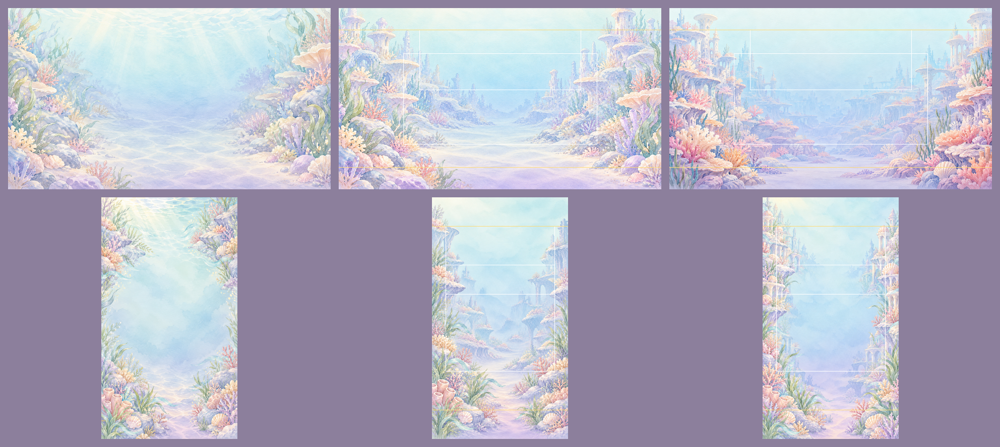
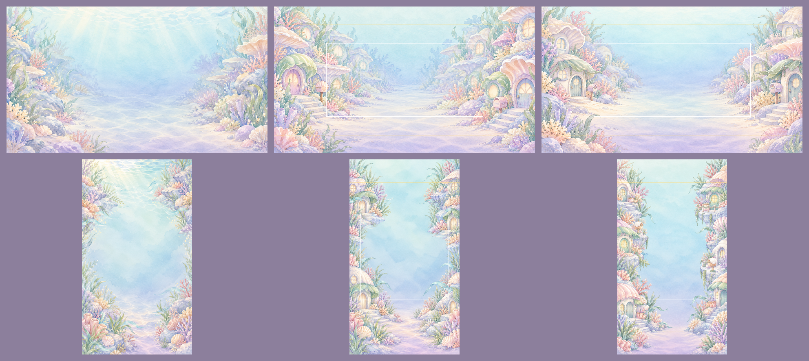
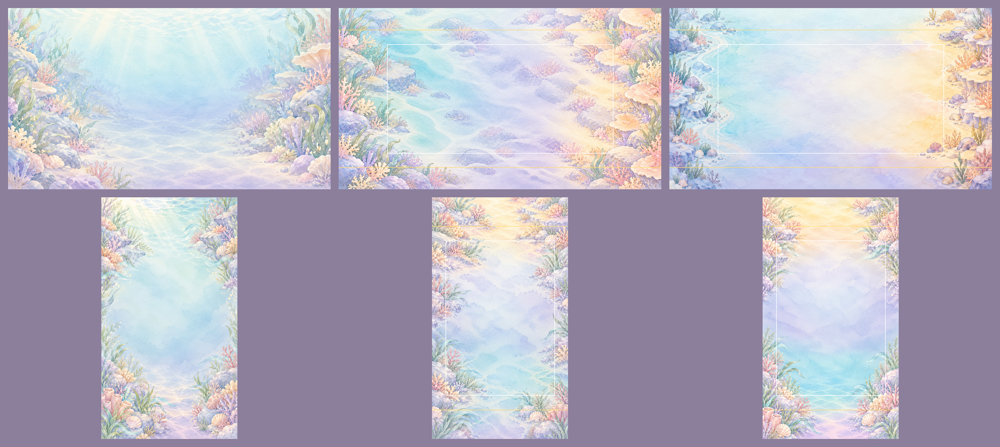
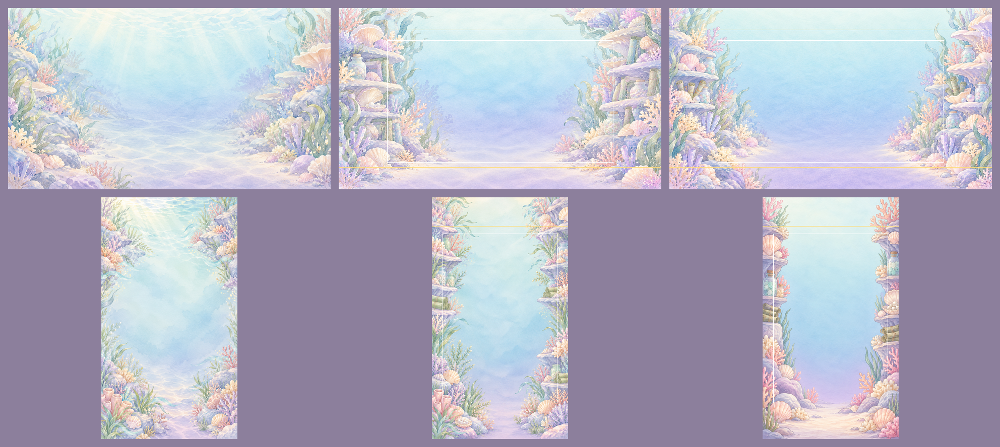
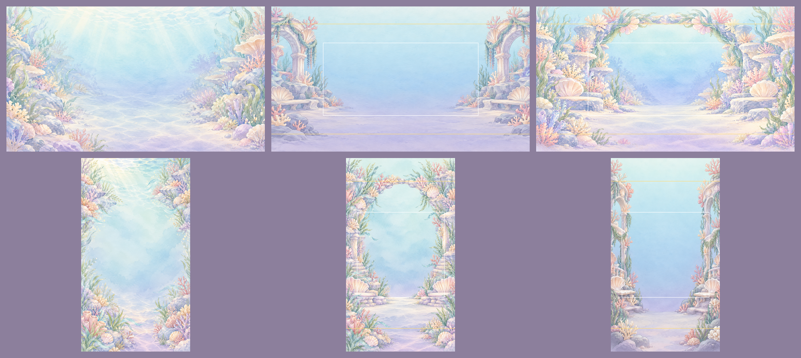

# 美術素材簽核對照頁 batch-20261023-screens

- 批次：`batch-20261023-screens`
- 生成日期：2026-10-23
- 整理：art-director（AI）依委託單產出並自檢，不代表通過，全部等待人類終審
- 委託單：`docs/art/orders/20261023-screen-backgrounds.md`
- 工具：Codex CLI 0.162.1 內建圖像生成，腳本 `tools/art/gen-screen-bg.mjs`，並行度 3，未遇到配額或速率限制
- 參考圖（`-i` 帶入）：同方向的 `bg-battle-<方向>-b.png`、`assets/_source/portraits/xiaoye.png`
- 提示詞全文：`../../assets/pending/batch-20261023-screens/prompts.md`
- 後製：`tools/art/post-screen-bg.py`；量測：`tools/art/check-screen-bg.py`；拼圖：`tools/art/contact-screen-bg.py`
- 下方「選用」是 art-director 建議，已複製到 `assets/backgrounds/` 供工程端試接，人類可改選或退回

## 總覽

**選用的 10 張與對戰背景並排，整體讀得出同一系列**

- 上兩列橫式：對戰、title、menu／story、deck、picker
- 下一列直式：對戰、title、menu、story、deck、picker

## 量測說明

**數值越低越乾淨；以對戰背景 b 當基準**

- 中央：中央區亮度標準差；比：中央 ÷ 全圖，委託單門檻低於 0.5
- 標題區：title 專用，橫式 x 25% 到 75%、y 12% 到 45%；直式 x 10% 到 90%、y 12% 到 40%
- 上 12%、下 12%：該帶亮度標準差
- 波光中段：上 12% 中段 x 25% 到 75%，比局部模糊亮 12 以上的像素比例，用來抓水面波光
- 色差：平均亮度、飽和度、冷暖（R 減 B）與同方向對戰背景 b 的差
- 基準值
  - 對戰橫式 b：中央 10.9、比 0.55、上 13.2、下 18.8、波光中段 0.04%
  - 對戰直式 b：中央 9.5、比 0.46、上 22.1、下 25.0、波光中段 5.85%

## 1. title 標題畫面

- 每張 contact sheet：上列橫式「對戰 b、a、b」，下列直式「對戰 b、a、b」；白框為中央區（title 另有標題區），黃線為上下 12%
- 變體與量測
  - landscape-a：中央 14.6、比 0.69、標題區比 0.39、上 10.5、下 20.9、波光中段 0%；色差 亮度 +0.6、飽和 +2.9、冷暖 -1.4
  - landscape-b：中央 12.0、比 0.49、標題區比 0.29、上 8.1、下 27.5、波光中段 0%；色差 亮度 -6.8、飽和 +11.5、冷暖 -4.7
  - portrait-a：中央 14.6、比 0.67、標題區比 0.54、上 9.4、下 24.6、波光中段 0%；色差 飽和 +2.0、冷暖 -4.0
  - portrait-b（重出）：中央 12.3、比 0.61、標題區比 0.65、上 10.4、下 26.7、波光中段 0%
    - 初版：中央 18.4、比 0.79
- 選用
  - 橫式 b → `assets/backgrounds/bg-title-landscape.webp`
    - 全批唯一中央比與標題區比都過門檻，珊瑚塔層次最有氣勢
    - 飽和度比對戰高 11.5，粉紅珊瑚較鮮
  - 直式 a → `assets/backgrounds/bg-title-portrait.webp`
    - 標題區比 0.54 優於 b 的 0.65，色差最小
    - 左上珊瑚塔略伸入標題區，標題比略高於門檻
- 人類終審：通過

## 2. menu 主選單

- 變體與量測
  - landscape-a：中央 15.9、比 0.77、上 16.9、下 18.1、波光中段 0.07%；色差 亮度 -1.4、飽和 -0.1、冷暖 +9.3
  - landscape-b（重出）：中央 14.8、比 0.69、上 14.9、下 18.3、波光中段 0%；色差 亮度 +1.4、飽和 -0.4、冷暖 +7.8
    - 初版：中央 22.5、比 0.95，偏暗偏飽和
  - portrait-a：中央 15.9、比 0.71、上 20.5、下 25.4、波光中段 0.28%；色差 飽和 +3.4、冷暖 -1.9
  - portrait-b（重出）：中央 18.9、比 0.81、上 20.7、下 24.0、波光中段 0.58%
    - 初版：中央 19.5、比 0.82
- 選用
  - 橫式 b → `assets/backgrounds/bg-menu-landscape.webp`
    - 珊瑚屋與信箱只在左右兩側，中央街道最空；亮度與飽和度幾乎與對戰相同
  - 直式 a → `assets/backgrounds/bg-menu-portrait.webp`
    - 中央比低於 b，邊緣珊瑚屋層次接近對戰直式
- 人類終審：通過

## 3. story 劇情章節地圖

- 區域排列：橫式由左到右潮、霜、光；直式由下到上潮、霜、光
- 變體與量測
  - landscape-a：中央 14.1、比 0.66、上 19.2、下 24.1、波光中段 4.46%；色差 飽和 +5.0、冷暖 +12.4
  - landscape-b（重出）：中央 9.5、比 0.43、上 20.5、下 19.7、波光中段 0%；色差 亮度 +1.1、飽和 +7.2、冷暖 +10.3
    - 初版：中央 14.6、比 0.69、冷暖 +20.0
  - portrait-a：中央 16.6、比 0.76、上 24.6、下 23.1、波光中段 12.08%
  - portrait-b（重出）：中央 13.5、比 0.66、上 21.7、下 26.1、波光中段 2.38%；色差 亮度 +1.4、飽和 +6.7、冷暖 +4.7
    - 初版：中央 17.6、比 0.72
- 選用
  - 橫式 b → `assets/backgrounds/bg-story-landscape.webp`
    - 中央比 0.43 過門檻，三區以大面積色塊漸層銜接，最適合放關卡節點
    - 俯瞰感較弱，偏「左右兩岸」的構圖
  - 直式 b → `assets/backgrounds/bg-story-portrait.webp`
    - 中央與上帶波光都低於 a；上鵝黃、中薰衣草、下淡青三區清楚
    - 下方淡青區有一段水紋，位置約在 y 75% 到 88%，大部分在下 12% 之外
- 人類終審：通過

## 4. deck 收藏與牌組

- 變體與量測
  - landscape-a：中央 15.5、比 0.72、上 21.8、下 16.5、波光中段 1.63%；色差 飽和 +3.8、冷暖 -0.5
  - landscape-b（重出）：中央 13.8、比 0.66、上 14.3、下 18.4、波光中段 0%；色差 飽和 +10.8、冷暖 -7.9
    - 初版：中央 18.0、比 0.78
  - portrait-a：中央 18.1、比 0.80、上 21.8、下 24.3、波光中段 1.65%；色差 亮度 -5.9、飽和 +4.9
  - portrait-b（重出）：中央 18.4、比 0.76、上 20.1、下 28.2、波光中段 0%；色差 亮度 -6.3、飽和 +11.6
    - 初版：中央 23.5、比 0.89
- 選用
  - 橫式 b → `assets/backgrounds/bg-deck-landscape.webp`
    - 貝殼架、玻璃罐、海帶卷軸只在兩側，中央是乾淨的水彩漸層
    - 左側一個卷軸上有很小的箭頭狀筆畫，縮圖看不出，請人眼確認
  - 直式 a → `assets/backgrounds/bg-deck-portrait.webp`
    - 中央數值與 b 相同，但 b 重出後筆觸變平、少了水彩顆粒，a 與對戰筆觸較一致
- 人類終審：通過

## 5. picker 自由對戰選對手

- 變體與量測
  - landscape-a（重出）：中央 8.7、比 0.48、上 15.6、下 7.6、波光中段 0%；色差 亮度 -9.7、飽和 +10.3、冷暖 -14.1
    - 初版：中央 21.8、比 0.87，拱門橫跨上方中段
  - landscape-b：中央 18.9、比 0.84、上 18.2、下 17.4、波光中段 16.16%（拱門頂的花環在上帶中段）
  - portrait-a：中央 18.2、比 0.77、上 22.4、下 24.6、波光中段 9.28%
  - portrait-b（重出）：中央 16.5、比 0.68、上 15.0、下 26.6、波光中段 0%；色差 亮度 -11.0、飽和 +7.6、冷暖 -10.7
    - 初版：中央 18.4、比 0.80
- 選用
  - 橫式 a → `assets/backgrounds/bg-picker-landscape.webp`
    - 中央比 0.48 過門檻，兩側拱門與貝殼長椅留出完整中央
    - 珊瑚量少、筆觸偏平、偏冷，是 10 張中與對戰差最多的一張
  - 直式 b → `assets/backgrounds/bg-picker-portrait.webp`
    - 中央與上帶都優於 a；同樣偏冷、筆觸偏平
- 人類終審：通過

## 驗收標準自檢

- 5 畫面 x 2 方向 x 2 變體齊全：通過
- 尺寸與格式：通過
  - 全部 1920 x 1080 或 1080 x 1920，WebP q85 與 PNG 齊全，WebP 146KB 到 312KB
  - Codex 原圖為 1672 x 941 或 941 x 1672，後製放大約 1.15 倍，與對戰背景相同
- 命名：通過，正式檔 `bg-<畫面>-<方向>.webp`
- 中央比低於 0.5：部分通過
  - 通過：title 橫式、story 橫式、picker 橫式
  - 未過：其餘 7 張選用圖 0.66 到 0.77；對戰背景 b 橫式本身也是 0.55
  - 原因：邊緣的珊瑚屋、書架、塔會伸進量測框；視覺上中央已是平塗，但數值未達標
- 上下 12%：上帶通過、下帶部分偏高
  - 上 12% 中段波光：選用圖 0% 到 2.4%，全部低於對戰直式 5.85%，對戰背景的水面波光問題已避開
  - 下 12% 標準差：多數 18 到 27，與對戰直式 25.0 相近，但高於對戰橫式 18.8；來自底部珊瑚與貝殼
- 不含文字、角色、生物主體、強烈光束、漂浮主體：art-director 目視通過，待人眼確認
- 與對戰背景系列一致：見下節

## 風格一致度

- 一致
  - 透明水彩、色鉛筆紋、紫灰細描邊、左上柔光、薰衣草暗部
  - 上青下紫的主漸層，珊瑚粉、杏、奶白點綴
- 偏差
  - title 橫式、deck、story 飽和度高 7 到 12，粉紅珊瑚較鮮
  - picker 兩張與 deck 直式重出版筆觸較平、紙紋較少；picker 偏冷 11 到 14
  - 對戰背景有光束與水面波光，本批依需求拿掉，所以本批整體比對戰「更安靜」

## 未解問題

- 中央比門檻：要放寬門檻，或改用 UI 實際覆蓋區當量測框，由人類決定
- story 的三區排列方向是 art-director 自訂，需與關卡節點排版對齊
- title 直式標題區比 0.54，略高於門檻；若標題字很細，可能要再重出
- 程式端尚未接入，實機截圖待工程端配合

## 人類簽核

- art-director 初審：建議採用上述 10 張，2026-10-23
- 人類終審：通過
- 選用變體：照美術總監建議
- 簽核人：Sunny Wu（口頭授權，Claude 代簽）
- 簽核日期：2026-10-23
