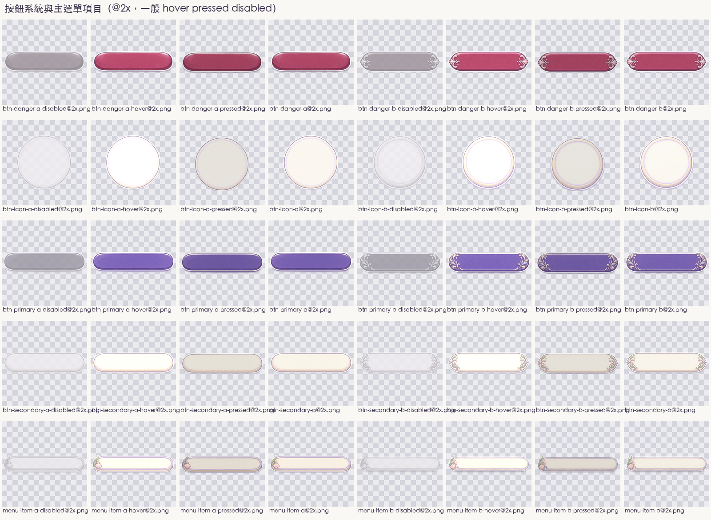
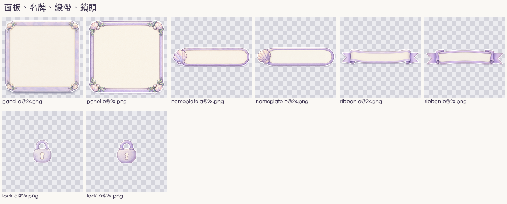
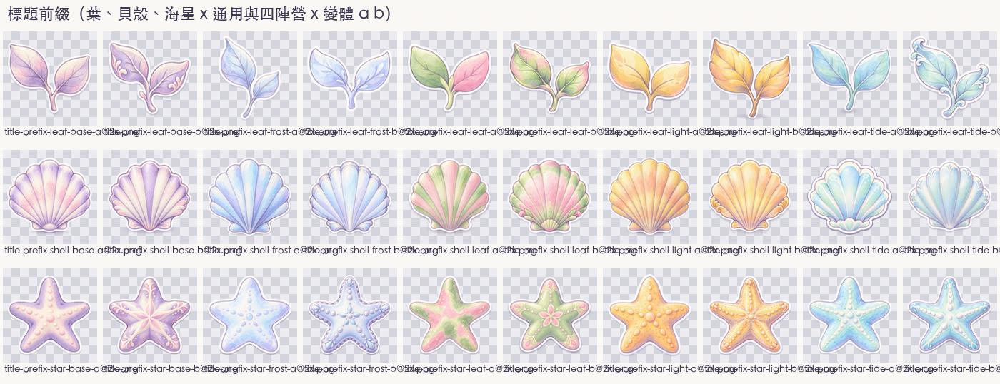
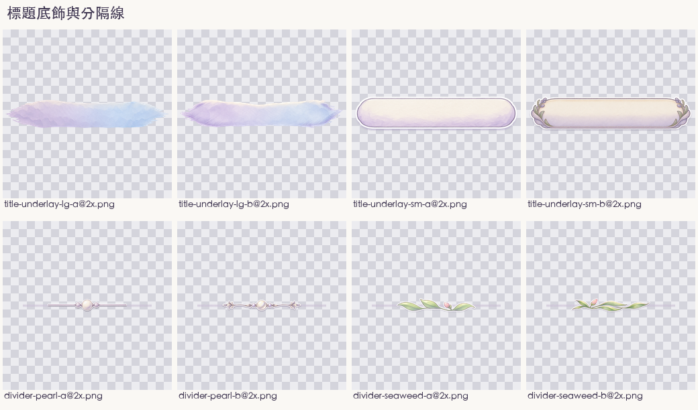
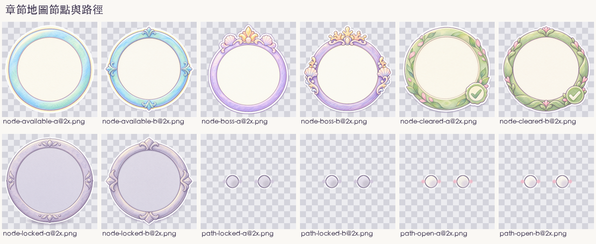
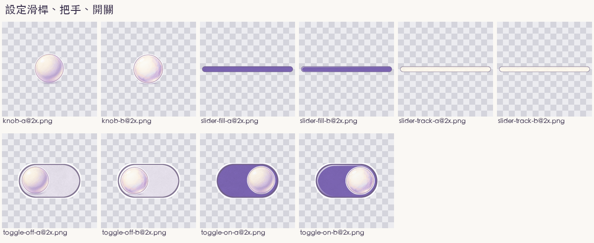
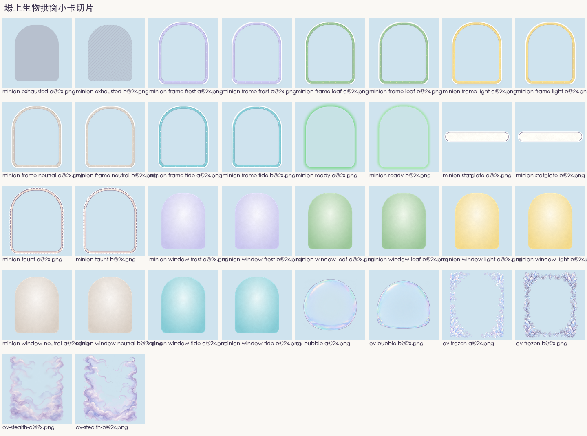

# 美術素材簽核對照頁 batch-20261023-ui

- 批次：`batch-20261023-ui`
- 生成日期：2026-10-23
- 整理：AI 依委託單產出並自檢，不代表通過，全部等待人類終審
- 委託單：`docs/art/orders/20261023-ui-kit.md`；按鈕規格：`docs/ux-buttons.md`；盤點報告：`docs/art/audit-20261023-ui.md`
- 風格參考圖（以 `-i` 帶入 Codex）
  - `assets/_source/portraits/xiaoye.png`
  - `assets/pending/batch-20261023-ui/_refs/ref-icons.png`（已上線 icon-cost、icon-attack、icon-health、icon-faction-leaf）
  - `assets/pending/batch-20261023-ui/_refs/ref-card-frame-leaf.png`（已上線卡框 a 套）
  - `assets/pending/batch-20261023-ui/_refs/ref-bg-battle.png`（已上線對戰背景 landscape-b）
- 來源腳本
  - Codex 出圖：`tools/art/gen-ui-kit.mjs`（36 項 x 2 變體，共 72 張原圖，`_raw/prompts.json` 留每張 prompt）
  - 後製與程序化切片：`tools/art/ui-kit.py`（重用 `tools/art/card-frame.py` 的筆觸與陣營色）
  - 預覽：`_preview/html/preview.html` 加 `render.mjs`（HTML 合成）、`tools/art/preview-minion-board.py`（Pillow 合成）、`tools/art/compare-ui-kit.py`（前後對照）
  - contact sheet：`tools/art/contact-ui-kit.py`
- 全批自檢（284 個 PNG 切片，各有同名 WebP）
  - 1x 與 @2x 尺寸比 2:1：284 個全數符合
  - 四角 alpha 為 0：全數符合（例外 `minion-window-*`、`slider-*`、`title-underlay-*` 依設計貼齊畫布邊）
  - Codex 72 張首輪全部成功，沒有碰到配額或速率限制
- 下方「美術總監建議」只是建議，選用與否由人類決定

## 1. 按鈕設計系統（含主選單按鈕外框）

**主色 `#7A64B0` 取自結束回合；主要、次要、危險、圖示、主選單五類各 a、b 兩款，每款四種狀態**

### 變體清單

- 目錄：`../../assets/pending/batch-20261023-ui/buttons/`
- 每類檔名：`<類>-<變體>`、`-hover`、`-pressed`、`-disabled`，各有 1x、@2x、PNG、WebP
  - `btn-primary`、`btn-secondary`、`btn-danger`：1x 240 x 64
  - `btn-icon`：1x 64 x 64
  - `menu-item`：1x 440 x 96
- a 柔和水彩：膠囊形、紙紋底、下緣厚度，兩端無裝飾
- b 色鉛筆裝飾：兩端多一對捲草紋，主選單多一段海草

### 縮圖對照

- 總表（層級 x 六種狀態，含尺寸與主選單項目）
  - `../../assets/pending/batch-20261023-ui/_preview/after-buttons-a-1440x900.png`
  - `../../assets/pending/batch-20261023-ui/_preview/after-buttons-b-1440x900.png`

- 套用到各畫面：主選單、結算、設定見第 7 節；結束回合按鈕的新外觀以總表「主要 大 64」為準

### 驗收標準自檢

- 四種狀態齊全：通過，5 類 x 2 變體 x 4 狀態 = 40 組
- 九宮格拉伸：通過，預覽中主要按鈕從 88 拉到 300 寬，端蓋不變形
- 文字對比：通過
  - 主要白字 4.91:1、hover 6.21:1、危險白字 5.21:1、次要深字 11.28:1、停用 5.27:1
- 動態：通過，狀態只換亮度與光暈，按下下沉 2px，沒有縮放
- 禁止事項：通過，沒有文字、數字、五官

### 規格偏差與風險

- 主要按鈕原圖顏色偏亮，後製以 `recolor_fill` 校到 `#7A64B0`，紙紋保留但色彩比原圖平
- `btn-icon-a` 重出後沒有下緣厚度，與次要按鈕的下緣不完全一致，CSS 用 `box-shadow` 補
- b 套兩端捲草紋在小尺寸（高 44）會糊成一團，小按鈕建議一律用 a

### 美術總監建議

- 建議採用：a 套為全站標準，主選單項目可用 b 套（只有一處、尺寸大，裝飾看得清楚）
- 理由：a 與已選用的卡框 a 套同一個筆觸強度；b 的裝飾在 44 高的按鈕上變雜訊

### 人類簽核

- art-director 初審：建議 a 套，主選單項目用 b
- 人類終審：通過
- 選用變體：照美術總監建議
- 簽核人：Sunny Wu（口頭授權，Claude 代簽）
- 簽核日期：2026-10-23

## 2. 通用面板、名牌、緞帶

### 變體清單

- `../../assets/pending/batch-20261023-ui/panels/panel-<a|b>`：1x 480 x 480，九宮格四邊 64
- `../../assets/pending/batch-20261023-ui/labels/nameplate-<a|b>`：1x 200 x 52，九宮格左右 26
- `../../assets/pending/batch-20261023-ui/labels/ribbon-<a|b>`：1x 400 x 84，九宮格左右 76
- `../../assets/pending/batch-20261023-ui/icons/lock-<a|b>`：1x 32 x 32

### 縮圖對照

### 驗收標準自檢

- 面板四角裝飾落在 64 安全區內：通過，拉成 1000 x 360 的章節卡片沒有裝飾被拉長
- 名牌左端貝殼不拉伸：通過
- 緞帶燕尾不拉伸：通過，結算預覽拉到 460 寬
- 鎖頭縮到 24 仍可辨認：通過

### 規格偏差與風險

- panel-b 四角裝飾較大，用在小彈窗（寬 520 以下）時四角會擠
- 面板中段的紙紋是 Codex 原圖拉伸，拉很寬時紋理會被拉長，近看可見

### 美術總監建議

- 建議採用：panel-a、nameplate-a、ribbon-b、lock-a
- 理由：面板與名牌高頻出現，選低調的 a；緞帶只在結算出現一次，b 的燕尾折痕更有儀式感

### 人類簽核

- art-director 初審：panel-a、nameplate-a、ribbon-b、lock-a
- 人類終審：通過
- 選用變體：照美術總監建議
- 簽核人：Sunny Wu（口頭授權，Claude 代簽）
- 簽核日期：2026-10-23

## 3. 共用標題組（前綴裝飾、標題底飾、分隔線）

**三件可自由組合；前綴 3 造型 x 5 配色 x 2 變體共 30 張，底飾大小兩級，分隔線兩款**

### 變體清單

- 標題前綴：`../../assets/pending/batch-20261023-ui/title/title-prefix-<leaf|shell|star>-<base|leaf|tide|frost|light>-<a|b>`
  - 1x 64 x 64（顯示 48 到 64），@2x 128 x 128
  - base 為通用款（薰衣草紫、奶白、粉），其餘四款對應葉、潮、霜、光陣營
- 標題底飾
  - 大標：`title-underlay-lg-<a|b>`，1x 560 x 96，九宮格左右 115，水彩刷痕、無白邊
  - 小標：`title-underlay-sm-<a|b>`，1x 280 x 60，九宮格左右 30，標籤形
- 分隔線：`divider-pearl-<a|b>`、`divider-seaweed-<a|b>`，1x 96 x 24，`repeat-x` 平鋪
- 未出項目
  - 小葉觸角剪影：單獨的觸角容易被看成角色局部，與「無五官、完整角色」原則衝突，建議不做
  - 泡泡串：與背景上升泡泡語意重複，靜態泡泡串放在標題前會被誤讀為動態元件，建議不做
  - 若仍要，請在簽核欄註明，下一輪補出

### 縮圖對照

### 套用預覽

- 組合總表：`../../assets/pending/batch-20261023-ui/_preview/after-titles-<a|b>-<1440x900|844x390>.png`
- 實際頁面
  - 主選單：`after-menu-*`（shell-base + 大標底飾 + 珍珠線）
  - 劇情地圖：`after-map-*`（leaf-base + 大標 + 海草線；章節小標用該章敵方陣營配色）
  - 收藏：`after-deck-*`（leaf-leaf + 大標；分頁用小標底飾）
  - 設定：`after-settings-*`（star-base + 小標 + 海草線）
  - 結算：`after-result-*`（緞帶主標 + 珍珠線）

### 驗收標準自檢

- 透明背景：通過
- 禁止文字與五官：通過
- 靜態構圖：通過，30 張前綴都是正放，沒有動態線與飛散亮點
- 分隔線平鋪無接縫：通過，腳本把底線畫滿整個週期，裝飾單元置中
- 陣營配色正確：通過，人眼比對 art-style.md 色票

### 規格偏差與風險

- 大標底飾原圖比文字寬很多，標題字短時兩端空白過長，程式端要依字寬設 `min-width`
- `leaf-tide-b`、`shell-tide-b` 多了捲草紋，與其他前綴的簡潔程度不一致
- 分隔線的裝飾間距固定 96，寬度不是 96 的倍數時兩端會切到半個珍珠，程式端用 `background-position: center`

### 美術總監建議

- 建議採用：前綴 a 套全部、底飾大小都用 a、分隔線兩款都用 a
- 理由：a 套前綴輪廓最乾淨，縮到 48 仍好認；b 套的花紋在 48 會糊

### 人類簽核

- art-director 初審：前綴 a、底飾 a、分隔線 a
- 人類終審：通過
- 選用變體：照美術總監建議
- 簽核人：Sunny Wu（口頭授權，Claude 代簽）
- 簽核日期：2026-10-23

## 4. 章節地圖節點與路徑

### 變體清單

- `../../assets/pending/batch-20261023-ui/map/node-<locked|available|cleared>-<a|b>`：1x 112 x 112
- `../../assets/pending/batch-20261023-ui/map/node-boss-<a|b>`：1x 136 x 136
- `../../assets/pending/batch-20261023-ui/map/path-<open|locked>-<a|b>`：1x 64 x 24，程序化

### 縮圖對照

### 驗收標準自檢

- 四種狀態可分：通過，鎖定灰紫、可挑戰藍綠加暖光、已通關葉綠加勾章、Boss 紫框加花冠
- 中央圓盤留給頭像：通過，預覽已疊對手頭像
- 路徑平鋪無接縫：通過
- 色弱可辨：通過，四種狀態除了顏色還有形狀差（勾章、花冠、鎖頭）

### 規格偏差與風險

- 可挑戰節點的暖光是畫在圖裡的靜態光暈，程式端若要提示「可點」，只能再疊光暈透明度變化，不可縮放
- 已通關的勾章是圖示不是文字，但仍屬「符號」，若人類認為與「禁止文字」衝突可改用程式疊

### 美術總監建議

- 建議採用：node 全部 a、node-boss b、path a
- 理由：a 的圓環最乾淨，頭像是主角；Boss 需要更隆重，b 多兩側貝殼與捲草更有份量

### 人類簽核

- art-director 初審：node a、node-boss b、path a
- 人類終審：通過
- 選用變體：照美術總監建議
- 簽核人：Sunny Wu（口頭授權，Claude 代簽）
- 簽核日期：2026-10-23

## 5. 設定元件（滑桿、把手、開關）

### 變體清單

- `../../assets/pending/batch-20261023-ui/settings/slider-track-<a|b>`、`slider-fill-<a|b>`：1x 240 x 16，程序化
- `../../assets/pending/batch-20261023-ui/settings/knob-<a|b>`：1x 32 x 32，Codex 珍珠
- `../../assets/pending/batch-20261023-ui/settings/toggle-<off|on>-<a|b>`：1x 64 x 36，程序化加珍珠把手

### 縮圖對照

### 驗收標準自檢

- 觸控目標：通過，把手顯示 36，整列可點高度 44
- 開關兩態可分：通過，開為主色、關為淡灰紫，把手位置也不同
- 對比：通過，已填段 `#7A64B0` 對奶白軌道 4.83:1

### 規格偏差與風險

- 軌道與開關為程序化，紙紋比 Codex 圖平，近看與珍珠把手的質感有落差
- 原生 `input[type=range]` 換皮要分別寫 `::-webkit-slider-thumb` 與 `::-moz-range-thumb`，Safari 對 `border-image` 支援要實測

### 美術總監建議

- 建議採用：a 套
- 理由：a、b 差異只在顆粒，a 與按鈕 a 套一致

### 人類簽核

- art-director 初審：a 套
- 人類終審：通過
- 選用變體：照美術總監建議
- 簽核人：Sunny Wu（口頭授權，Claude 代簽）
- 簽核日期：2026-10-23

## 6. 場上生物外觀（拱窗小卡）

**三個方向比較後選定「拱窗小卡」；12 隻生物擺滿雙方 6 格，涵蓋守護、潛藏、泡泡盾、冰凍、可攻擊、已攻擊、受傷、增益與疊加**

### 設計方向

- A 拱窗小卡（選定）：與手牌卡框同一套陣營色與花紋，守護、冰凍、泡泡都有固定外框可依附
- B 圓形徽章：最省空間，但插畫裁切最多，守護外環與泡泡盾都是圓形，疊起來分不開
- C 貼紙加底座：最可愛，但沒有外框，冰凍與守護只能畫在角色周圍，跟角色白邊打架
- 完整比較見 `docs/art/audit-20261023-ui.md` 第 6 節

### 變體清單

- 目錄：`../../assets/pending/batch-20261023-ui/minion/`，畫布 1x 288 x 352
- 程序化：`minion-frame-<陣營>`、`minion-window-<陣營>`、`minion-taunt`、`minion-ready`、`minion-exhausted`、`minion-statplate`
- Codex：`ov-bubble`、`ov-frozen`、`ov-stealth`
- 攻血圖示沿用已上線 `icon-attack`、`icon-health`

### 縮圖對照

### 6 格戰場預覽

- b 套：`../../assets/pending/batch-20261023-ui/_preview/board-b-1440x900.png`、`board-b-844x390.png`
- 前後對照：`../../assets/pending/batch-20261023-ui/_preview/compare-minion-a-1440x900.png`
- 預覽尺寸：桌機每隻約 120 x 147，手機約 80 x 98（現況約 90 與 50）

### 驗收標準自檢

- 辨識度：通過，陣營色在外框，插畫比現況大約 1.6 倍
- 數值可讀性：通過，手機 80 寬時攻血數字約 16px 高，白字深描邊
- 狀態疊加：通過，預覽「守護＋冰凍＋受傷」「已攻擊＋守護＋泡泡」都能分辨
  - 守護看扇貝外環輪廓、冰凍看冰晶框、泡泡看外罩高光、已攻擊看灰階
- 動態：只允許 `minion-ready` 透明度 0.7 到 1.0 循環；其餘狀態靜態
- 與手牌一致：通過，同陣營色、同花紋、同紙紋顆粒

### 規格偏差與風險

- 泡泡盾外罩疊在數字底座下面，泡泡邊緣會蓋到左右攻血圖示的外圈，這是刻意讓數字永遠在最上層
- 潛藏霧紗加插畫透明度 55% 後，淺色角色（冰晶小海星）在淺色背景上會太淡，程式端可改 65%
- 手機尺寸放大到 80 需要 `battleLayout.ts` 重新驗證雙方兩列與手牌的垂直空間
- 程序化外框的紙紋比 Codex 圖平，與 ov 系列並排時質感略有落差

### 美術總監建議

- 建議採用：a 套外框與窗底、ov-bubble-a、ov-frozen-a、ov-stealth-a、minion-exhausted-a
- 理由：b 套冰晶框太密，疊在小尺寸上會蓋掉插畫；已攻擊的斜排線 b 在手機上會閃爍成摩爾紋

### 人類簽核

- art-director 初審：a 套
- 人類終審：通過
- 選用變體：照美術總監建議
- 簽核人：Sunny Wu（口頭授權，Claude 代簽）
- 簽核日期：2026-10-23

## 7. 套用預覽（前後對照）

**左為 2026-10-23 現況截圖，右為套上新素材；背景已換成 `batch-20261023-screens` 的 a 變體示意**

- 主選單：`../../assets/pending/batch-20261023-ui/_preview/compare-menu-a-1440x900.png`、`compare-menu-a-844x390.png`

- 章節地圖：`compare-map-a-1440x900.png`、`compare-map-a-844x390.png`

- 設定面板：`compare-settings-a-1440x900.png`、`compare-settings-a-844x390.png`

- 結算面板：`compare-result-win-a-*`、`compare-result-lose-a-*`

- 關卡彈窗：`compare-popup-a-*`；自由對戰選對手：`compare-picker-a-*`；收藏：`compare-deck-a-*`
- 全部 b 套同名換 `-b-`；總覽 `../../assets/pending/batch-20261023-ui/contact-overview.png`

### 預覽裡的需求外示意（未定案，需人類決定）

- 設定面板多了「減少動態」開關與右上關閉鈕：現有 `SettingsDialog.vue` 沒有這兩項，只為展示開關與圖示按鈕外觀
- 結算面板多了「總傷害」：ux.md 1.1 有寫、程式沒做，沿用上一輪「要人類決定」第 8 項
- 收藏頁卡片以插畫代替完整卡面，只示意標題組與密度

## 重出紀錄

- 首輪 Codex 72 張全部成功
- 審稿後重出 2 張（`--force` 加嚴格補充句）
  - `ov-bubble-b`：首版底部多了一圈台座，看起來像玻璃罩不是泡泡盾；重出後為單一封閉外框，通過
  - `btn-icon-a`：首版下緣厚度過厚，比次要按鈕高一倍；重出後無厚度，改由 CSS 陰影補，通過
- 前一版保留在 `_raw/<id>.prev-<時間>.png`，對照圖 `_review/regen.png`
- 程序化切片自審後改版 3 次
  - 生物外框：首版白色 die-cut 填滿整個框內，窗底看不到，改成只畫外環
  - 守護外環：首版只有上緣一排扇貝，改成沿整圈等距扇貝
  - 生物投影：首版投影透進窗內，改成只在框外
